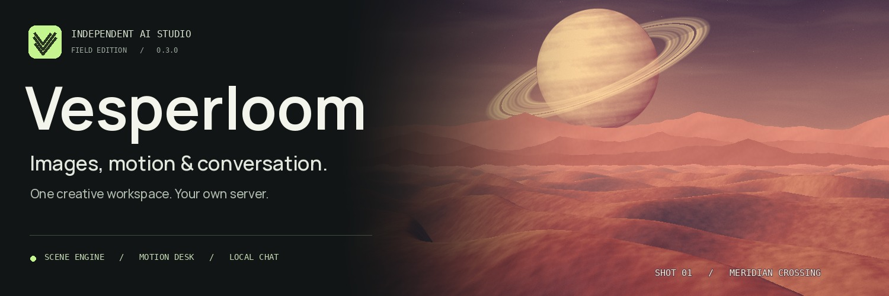
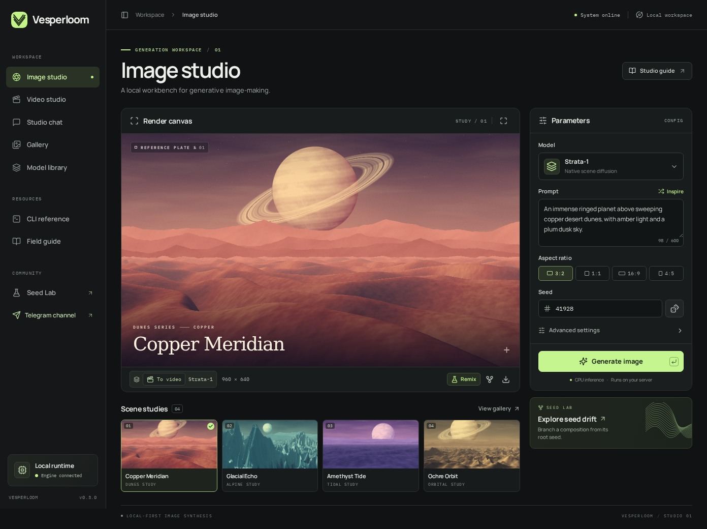

[English](README.md) · **Deutsch** · [Русский](README.ru.md) · [简体中文](README.zh-CN.md)

<!-- vesper-community:start -->
[**Seed Lab als HTML herunterladen ↓**](app/public/seed-lab.html?raw=true) &nbsp;·&nbsp; [Telegram-Kanal · @vesperloom7](https://t.me/vesperloom7)
<!-- vesper-community:end -->

# Vesperloom

**Selbst gehostetes KI-Studio für Bilder, Videos und Chat: eine Szene im Gespräch entwickeln, als Bild rendern und als Kamerafahrt exportieren.**

Das mitgelieferte **Strata-1** erzeugt atmosphärische Landschaften direkt auf der CPU. Für das erste Bild sind weder ein API-Schlüssel noch Python, eine GPU oder ein separater Modelldownload nötig. Für allgemeinere Bildmotive lassen sich zusätzliche Diffusionsmodelle über dieselbe React-Oberfläche, Node.js-API oder Kommandozeile ausführen.

## Drei verbundene Arbeitsbereiche

- **Bild:** Strata-1 erzeugt Landschaften ohne zusätzliche Downloads. Für allgemeine Motive stehen die optionalen SD-, SDXL- und FLUX-Pipelines bereit.
- **Video:** Strata Motion bewegt eine Kamera durch die generierte Landschaft. Ein fertiger Clip dauert 2–4 Sekunden, bleibt stumm und wird als H.264-MP4 exportiert (im Breitformat bis 1280×720 bei 24 Bildern/s). Das ist keine allgemeine Videodiffusion. Dafür gibt es separat Wan 2.1 T2V 1.3B: 28,93 GB Modellkomponenten plus GPU-Umgebung.
- **Chat:** `npm run chat:setup` installiert auf glibc-Linux x86-64 die CPU-Laufzeit und Qwen2.5 0.5B (0,49 GB Gewichte). Für mehr Kapazität: `npm run loom -- pull qwen-7b` (weitere 4,68 GB) oder ein vom Betreiber konfigurierter kompatibler Endpunkt. Bei einem externen Endpunkt werden die übermittelten Gesprächsbeiträge dorthin gesendet.

In **Studio chat** eine Antwort mit **To image** übernehmen. Den Vorschlag bearbeiten, das Bild erzeugen und dann **To video** wählen. Native Szenen behalten Seed und Sampling-Einstellungen; bei Fremdmodellen werden nur Beschreibung und Seed übernommen, nicht die Bildpixel. Gerendert wird erst nach Bestätigung.

[Beispielclip (MP4)](app/public/reels/meridian/clip.mp4?raw=true) · [Video-Oberfläche](docs/media/motion.jpg) · [Lokaler Chat](docs/media/chat.jpg) · [Installation und Hardware](docs/MULTIMODAL.md)

## Ohne Installation ausprobieren

**Seed Lab** enthält das echte Strata-1-Modell und den Renderer in einer einzigen HTML-Datei. Die Datei oben herunterladen und lokal im Browser öffnen – auch offline. Palette oder **Seed drift** ändern, eine Postkarte mit 1200×630 Pixeln exportieren oder den `VL1`-Code weitergeben. Jeden Montag (UTC) startet ein neuer **Weekly seed** mit derselben Ausgangskomposition für alle. Der Code enthält weder Prompt noch private Serveradresse. Zeigt GitHub den Quelltext, **Download raw file** wählen.

Neuigkeiten und Studien: [@vesperloom7 auf Telegram](https://t.me/vesperloom7). Wer eine Komposition teilen möchte, kann die Postkarte zusammen mit dem Seed-Code verschicken. Ein Stern auf GitHub hilft anderen, das Projekt zu entdecken.

[Seed Drift in Bewegung ansehen →](docs/media/seed-drift.gif)

## Schnellstart

Im entpackten oder geklonten Projektverzeichnis, mit **Node.js ab 20.19 und npm ab 10** (empfohlen: Node 22):

```bash
npm ci && npm start
```

Für alle drei Arbeitsbereiche auf glibc-Linux x86-64: `npm ci && npm run chat:setup && npm start`. Für mehrere eingeladene Nutzer zuerst getrennte Schlüssel mit `npm run workspace -- add mira` anlegen; danach den Dienst neu starten.

**http://127.0.0.1:4173** öffnen, eine Studie auswählen und auf **Generate image** klicken. Nur die Installation der npm-Pakete braucht Internetzugang; danach funktioniert die native Bilderzeugung offline. Die englischsprachige Oberfläche, die Schriftarten und die Vorschaubilder werden lokal ausgeliefert.

Auf einem VPS den Dienst auf der Loopback-Adresse belassen. Vom eigenen Rechner aus lässt sich der Port sicher weiterleiten:

```bash
ssh -L 4173:127.0.0.1:4173 user@your-vps
```

Alternativ startet `docker compose up -d --build` das native Studio mit einem dauerhaften Daten-Volume. Das mitgelieferte Container-Image enthält keine GPU-Laufzeitumgebung.



## Was erzeugt das Bild?

| | Nativ: Strata-1 | Externe Modelle |
| :--- | :--- | :--- |
| Verfahren | Trainierter Entrauscher mit 14.612 Parametern und analytischer Landschaftsrenderer | Lokale Inferenz mit PyTorch und Diffusers |
| Einsatzgebiet | Dünen, Gebirge, Gezeitenlandschaften und Planeten | Allgemeine Text-zu-Bild-Erzeugung je nach Modell |
| Hardware | CPU | In der Regel eine NVIDIA-GPU mit passender Python-Umgebung |
| Lieferumfang | Trainingscode, drei Gewichtsdateien und vier echte Referenzbilder | Vier Manifeste mit 74 festgelegten Komponenten; keine fremden Gewichte |

Strata-1 ist **kein universelles fotorealistisches Basismodell**. Ein nachvollziehbarer Wortfilter erkennt englische Begriffe für Landschaft und Palette. Das trainierte Netz erzeugt einen Code mit 20 Szenenparametern, aus dem der Renderer das Bild aufbaut. Details zu Trainingsdaten, Architektur und Messwerten stehen in der [Modellkarte](docs/models/STRATA-1.md).

## Drei Arbeitsweisen

- **Seed Drift:** Mit **Explore seed drift** eine Variante des aktuellen Bildes anlegen. Der Regler verschiebt den Startpunkt der Diffusion, während der Ausgangs-Seed und das Materialrauschen erhalten bleiben. Die neue Variante verweist auf ihr Ursprungsbild.
- **Replay-Kapseln:** Das Exportmenü speichert entweder die PNG-Datei oder eine kleine JSON-Datei mit Prompt, Geometrie, Seed, Drift, Modellidentität und Pixel-Prüfsumme. `replay` erzeugt das Bild erneut und meldet Abweichungen. Die Kapsel enthält den Prompt im Klartext.
- **Austauschbarer Runner:** Heruntergeladene Komponenten werden geprüft und erst dann gemeinsam freigegeben. Unterbrochene Installationen können bereits vollständige Dateien wiederverwenden. Eine normale Bildanforderung lädt niemals heimlich Gewichte nach.

```bash
npm run loom -- list
npm run loom -- run strata-1 --prompt "Cobalt dunes beneath a ringed planet" --seed 42 --out plate.png
npm run loom -- replay plate.png.capsule.json --out replay.png
```

## Externe Modelle

| Kennung | Modell | Dateien | Download |
| :--- | :--- | ---: | ---: |
| `sd15` | Stable Diffusion 1.5 | 15 | 2,74 GB |
| `sdxl` | SDXL Base | 18 | 6,94 GB |
| `sdxl-turbo` | SDXL Turbo | 18 | 6,94 GB |
| `flux-schnell` | FLUX.1 Schnell | 23 | 33,73 GB |

Zuerst die [GPU- und Installationsanleitung](docs/EXTERNAL-MODELS.md) lesen und die Lizenz des Herausgebers prüfen. Danach etwa `npm run loom -- pull sd15` und `npm run loom -- verify sd15` ausführen. Zugriffsbeschränkte Modelle setzen eine entsprechende Berechtigung voraus. `import` übernimmt einen passenden lokalen Snapshot. Die Verwaltung ist eigenständig implementiert; die Tensorberechnung externer Modelle übernimmt Diffusers. Es besteht keine Abhängigkeit von Ollama. Beliebige GGUF- und `.ckpt`-Dateien werden nicht unterstützt.

## Betrieb und Entwicklung

Ein aktiver Worker, höchstens acht wartende Aufträge, ein Zeitlimit von 20 Minuten und maximal 64 gespeicherte Bilder begrenzen den Ressourcenverbrauch. Benannte Arbeitsbereiche mit eigenen Zugriffsschlüsseln trennen Galerien, Clips und Aufträge. Ohne diese Schlüssel wird ein gemeinsamer Arbeitsbereich verwendet; kein anonymer öffentlicher Dienst. Aufträge im Arbeitsspeicher überleben keinen Neustart; fertig gespeicherte Bilder schon.

`app/` enthält die React-Oberfläche, `engine/strata/` Training und Inferenz, `registry/` die Modellmanifeste und `server/runtime/` die Warteschlange und Speicherung. `npm run dev` startet die Entwicklungsumgebung; `npm test` führt die Tests aus. Die externen Adapter wurden mit kleinen, zufällig initialisierten Testmodellen auf der CPU geprüft, nicht mit produktionsgroßen GPU-Checkpoints.

[Architektur](docs/ARCHITECTURE.md) · [HTTP-API](docs/API.md) · [VPS-Betrieb](docs/DEPLOYMENT.md) · [Prüfbericht](docs/VERIFICATION.md) · [Veröffentlichung](docs/PUBLISHING.md)

**Lizenz:** [MIT](LICENSE) für den eigenen Code, die Strata-1-Gewichte und die enthaltenen Studien. Externe Modelle und Bibliotheken behalten ihre eigenen Lizenzen; siehe [Drittanbieterhinweise](THIRD_PARTY_NOTICES.md).
