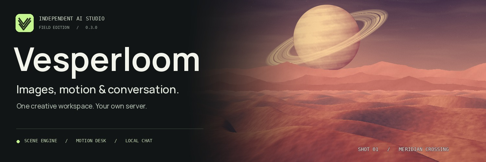
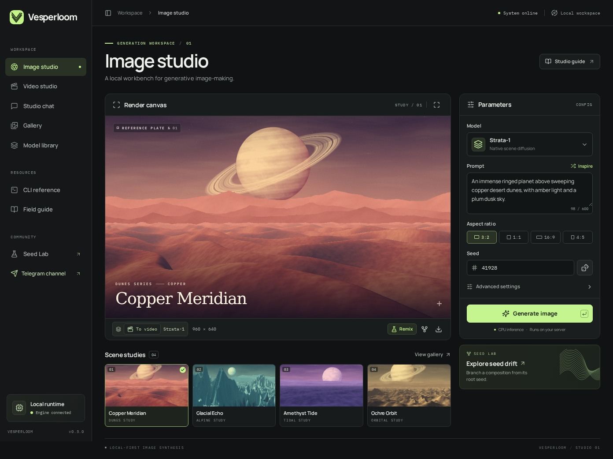

**English** · [Deutsch](README.de.md) · [Русский](README.ru.md) · [简体中文](README.zh-CN.md)

<!-- vesper-community:start -->
[**Download Seed Lab (HTML) ↓**](app/public/seed-lab.html?raw=true) &nbsp;·&nbsp; [Telegram channel · @vesperloom7](https://t.me/vesperloom7)
<!-- vesper-community:end -->

# Vesperloom

**Self-hosted AI studio for images, video and chat. Draft a scene, render a plate, then turn the same seed into a moving shot.**

Vesperloom ships **Strata-1**, an original, trained scene-code diffusion model for atmospheric landscape art. It renders its first PNG on a CPU, without an API key, a GPU or a model download. For broader text-to-image work, the same React studio, Node.js API and CLI can dispatch separately installed Stable Diffusion, SDXL and FLUX pipelines.

[Quick start](#quick-start) · [Native model card](docs/models/STRATA-1.md) · [External engines](docs/EXTERNAL-MODELS.md) · [HTTP API](docs/API.md) · [VPS deployment](docs/DEPLOYMENT.md)

## Three connected desks

| Desk | Runs on a CPU VPS | Optional upgrade |
| :--- | :--- | :--- |
| **Image studio** | Strata-1 synthesizes landscape plates from its bundled learned prior. | SD 1.5, SDXL, SDXL Turbo or FLUX for general prompts. |
| **Video studio** | Strata Motion animates the learned 3D terrain with a glide, dolly or arc. Export 2–4 s of silent H.264 MP4, up to 1280×720 at 24 fps in wide mode. | Wan 2.1 T2V 1.3B performs temporal diffusion for general scenes and action; separate 28.93 GB snapshot and GPU environment. |
| **Studio chat** | Stream real Qwen2.5 0.5B GGUF replies after `npm run chat:setup` on glibc Linux x86-64 (0.49 GB of weights). | Qwen2.5 7B Q4 (4.68 GB), or your operator-configured compatible chat endpoint. |

In **Studio chat**, choose **To image** on a reply. Edit the text, generate, then choose **To video** beneath the canvas. Native plates carry their scene seed and sampling settings into the director. External plates transfer a **prompt**, not input pixels. Nothing renders until you press the render button.

[Play the three-second reference shot (MP4)](app/public/reels/meridian/clip.mp4?raw=true) · [HD alpine sample · 720p24](docs/media/glacial-transit-hd.mp4?raw=true) · [Motion desk screenshot](docs/media/motion.jpg) · [Real local chat](docs/media/chat.jpg) · [Hardware, setup & privacy](docs/MULTIMODAL.md)

## Try the model before installing anything

**Seed Lab** is Strata-1 in a single HTML file: the actual checkpoint and renderer run in your browser. Download the file above and open it locally, even offline. Change the palette or drag **Seed drift**; export a 1200×630 postcard or pass a `VL1` code to someone else. **Weekly seed** gives everyone the same starting point each Monday (UTC). No accounts, analytics, or private prompts in remix codes. If the file opens in GitHub’s code viewer, use **Download raw file**.

Follow [@vesperloom7](https://t.me/vesperloom7) for release notes and seed studies. If you find a composition worth keeping, try sharing the card and its seed code. If the tool is useful to you, a GitHub star helps others discover it.

[Watch the seed-drift loop →](docs/media/seed-drift.gif)

## Quick start

From the extracted or cloned repository, with **Node.js 20.19+ and npm 10+** (Node 22 recommended):

```bash
npm ci && npm start
```

Open **http://127.0.0.1:4173**. Select a scene study, change the prompt, and choose **Generate image**. Installation needs network access for npm dependencies; native rendering afterward does not. The font files and artwork are served locally, too.

On a remote VPS, leave the service bound to loopback and forward the port from your own computer:

```bash
ssh -L 4173:127.0.0.1:4173 user@your-vps
```

For all three desks on glibc Linux x86-64, run `npm ci && npm run chat:setup && npm start` instead. This explicitly downloads the small chat model; image and motion rendering need no extra weights. For multiple invited users, [create named workspace keys](docs/MULTIMODAL.md#invite-only-private-workspaces) before sharing your server.

Or, for a native-only container with a persistent data volume:

```bash
docker compose up -d --build
```



## Image studio: two rendering paths

| | **Native · Strata-1** | **External · registered pipelines** |
| :--- | :--- | :--- |
| What generates the image | Trained 14,612-parameter denoiser + original analytic renderer | The selected upstream model, executed with local PyTorch/Diffusers |
| Good at | Art-directed dunes, glacial peaks, tidal seas and orbital landscapes | Broad text-to-image generation, depending on the checkpoint |
| Hardware | CPU; no Python at inference | Typically an NVIDIA GPU and a separate Python environment |
| Distribution | Source, training code, 3 real weight shards and 4 reference plates included | 4 manifests, 74 pinned component entries; **no third-party weights bundled** |
| Reproducibility | Seeded sampling, drift and verified pixel replay | Settings and hashes captured; GPU kernels can differ across machines |

**The native model is intentionally specialized.** It does not understand arbitrary subjects or compete with large photorealistic foundation models. Its English router selects a terrain family and palette; the learned prior generates composition parameters, not RGB pixels. See [what was actually trained and measured](docs/models/STRATA-1.md).

## Three things to try in Image studio

1. **Fork a landscape, not just a prompt.** Open *Copper Meridian*, choose **Explore seed drift**, and move the drift slider. The initial diffusion noise rotates toward a second seeded vector; the material field stays fixed. The new plate records its parent.
2. **Send a recipe that can prove what it made.** Open the canvas export menu and save a **replay capsule**. It carries the prompt, seed, drift, geometry, step count, checkpoint identity and SHA-256 of the decoded pixels. The CLI re-renders the image and reports a mismatch instead of pretending a replay succeeded.
3. **Change the engine without changing clients.** Install a registered snapshot from the CLI, then select it in the studio or pass its ID to the same `/api/jobs` endpoint. Pulls are staged, content-verified and committed by rename. Rendering never silently downloads a model.

## Headless workflow

```bash
npm run loom -- list
npm run loom -- run strata-1 --prompt "Cobalt desert dunes beneath an immense ringed planet" --seed 42 --out plate.png
npm run loom -- replay plate.png.capsule.json --out replay.png
```

Other commands: `doctor`, `inspect`, `pull`, `import`, `verify`, `remove`. Run `npm run loom -- help` for flags. CLI renders write to the output path you choose, not to the web gallery.

### Third-party model registry

| ID | Publisher / family | Selected files | Download |
| :--- | :--- | ---: | ---: |
| `sd15` | Stable Diffusion v1.5 | 15 | 2.74 GB |
| `sdxl` | Stability AI · SDXL Base | 18 | 6.94 GB |
| `sdxl-turbo` | Stability AI · SDXL Turbo | 18 | 6.94 GB |
| `flux-schnell` | Black Forest Labs · FLUX.1 Schnell | 23 | 33.73 GB |

Set up the [optional tensor runtime](docs/EXTERNAL-MODELS.md) and review the upstream license **before** requesting a download. For example, `npm run loom -- pull sd15` installs that exact snapshot; `npm run loom -- verify sd15` re-hashes it. Gated downloads require an authorized account. The runner is original orchestration, **not** a rewrite of PyTorch and **not** a wrapper around Ollama. Only the two registered GGUF profiles are supported in the chat adapter; arbitrary checkpoints and custom remote Python are not supported.

## Inside the repository

```text
seed-lab/              Offline browser instrument and privacy-limited remix format
community/             User-facing channel and optional public links
app/                   React studio, self-hosted assets and reference plates
bin/loom.mjs            Headless runner and model-management commands
engine/strata/          DDIM, denoiser, scene shaders, trainer and weight shards
engine/adapters/        Native and local image/Wan tensor workers
engine/motion/          Camera projection, H.264 encoding and a VP8 review proxy
runtimes/               Separate, opt-in CPU GGUF package, lockfile and worker
registry/              Pinned manifests, schema definitions and installer
server/api/            HTTP interface and media delivery
server/runtime/        Bounded visual queue, cancellation, persistence and capsules
server/chat/, video/   Streaming text and durable motion jobs
server/accounts/       Named workspace keyring (hashes, not cleartext tokens)
tests/                 Native/API/CLI tests and optional tensor smoke tests
docs/                  Model card, deployment, architecture, API and verification
deploy/                Example systemd unit
```

## Operations and development

- **Small-server behavior:** one active worker, eight pending jobs, a 20-minute deadline and a 64-render gallery. Partial results never appear as finished plates. One visual job and one chat reply may run concurrently. The opt-in workspace keyring isolates galleries, clips and jobs; it is not an anonymous SaaS endpoint.
- **Privacy:** no telemetry; native and GGUF inference stay on your server. Selecting a configured remote chat provider sends the included conversation to it. Prompts are saved with outputs in your own data directory. Exported capsules **contain the prompt**; review them before sharing.
- **Performance:** on the measured 2-vCPU Linux host, the median warm 960×640 native render was **561 ms** across seven runs. This is renderer time, not end-to-end latency or a GPU benchmark. [Method and limitations](docs/VERIFICATION.md).
- **Developer loop:** `npm run dev` runs Vite plus the local API. `npm test` runs the native test suite. `npm run build && npm run serve` separates the production build from serving. `npm run bench` measures your host.
- **Release checks:** [verification record](docs/VERIFICATION.md) · [architecture](docs/ARCHITECTURE.md) · [contributing](CONTRIBUTING.md) · [public-repo checklist](docs/PUBLISHING.md) · [Pages and Telegram launch guide](docs/LAUNCH.md).

## License

[MIT](LICENSE) covers the original Vesperloom code, Strata-1 weights, documentation and included study images. Dependencies and external checkpoints retain their own terms. See [third-party notices](THIRD_PARTY_NOTICES.md). Vesperloom is an independent project, not affiliated with the upstream model publishers.
