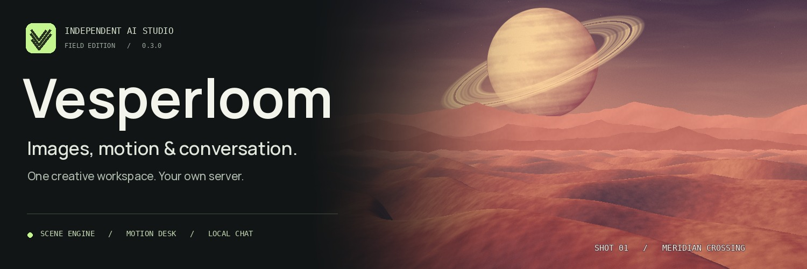
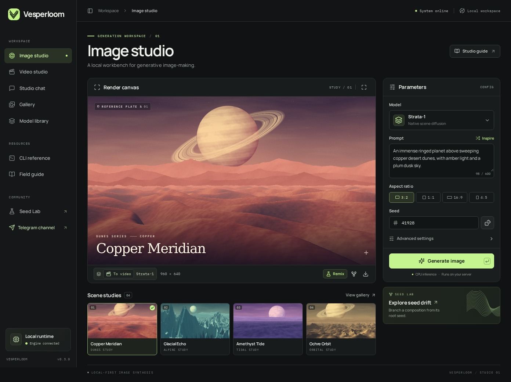

[English](README.md) · [Deutsch](README.de.md) · **Русский** · [简体中文](README.zh-CN.md)

<!-- vesper-community:start -->
[**Скачать Seed Lab (HTML) ↓**](app/public/seed-lab.html?raw=true) &nbsp;·&nbsp; [Telegram-канал · @vesperloom7](https://t.me/vesperloom7)
<!-- vesper-community:end -->

# Vesperloom

**ИИ-студия для своего сервера: обсудите идею в чате, превратите её в изображение и снимите короткий видеоплан в той же сцене.**

Встроенная **Strata-1** рисует пейзажи на обычном процессоре. Для первого изображения не нужны ключ API, видеокарта, Python или скачивание весов. Для более широкого круга задач через тот же интерфейс на React, API на Node.js и консольную утилиту можно запускать отдельно установленные модели Stable Diffusion, SDXL и FLUX.

## Три связанных рабочих пространства

- **Изображения.** Strata-1 рисует пейзажи без дополнительных загрузок. Для произвольных сюжетов можно отдельно установить SD, SDXL или FLUX.
- **Видео.** Strata Motion перемещает камеру по сгенерированному ландшафту. На выходе — немой H.264 MP4 длиной 2–4 секунды, в широком формате до 1280×720 при 24 кадрах/с. Это не универсальная видеодиффузия. Для генерации произвольного действия из текста предусмотрен Wan 2.1 T2V 1.3B: отдельный снимок на 28,93 ГБ и подходящая среда с GPU.
- **Чат.** На Linux x86-64 с glibc команда `npm run chat:setup` устанавливает CPU-движок и Qwen2.5 0.5B (0,49 ГБ весов). Доступны Qwen2.5 7B (`npm run loom -- pull qwen-7b`, ещё 4,68 ГБ) и совместимый сервер, выбранный администратором. Только в последнем случае включённая история отправляется этому серверу.

В **Studio chat** нажмите **To image**, отредактируйте описание и создайте изображение. Затем выберите **To video**. Для Strata сохраняются seed и параметры выборки; для внешнего изображения передаётся текст и seed, а не пиксели. Генерация запускается отдельной кнопкой.

[Пример видео (MP4)](app/public/reels/meridian/clip.mp4?raw=true) · [Видеостудия](docs/media/motion.jpg) · [Локальный чат](docs/media/chat.jpg) · [Установка и оборудование](docs/MULTIMODAL.md)

## Попробуйте модель без установки

**Seed Lab** — это настоящий Strata-1 вместе с рендерером в одном HTML-файле. Скачайте его и откройте в браузере: Интернет не нужен. Измените палитру или **Seed drift**, сохраните открытку 1200×630 либо отправьте другу код `VL1`. Каждому участнику **Weekly seed** доступно одно и то же исходное зерно до следующего понедельника по UTC. В коде нет промпта или адреса частного сервера. Если GitHub показывает исходник, нажмите **Download raw file**.

Канал проекта с новостями и этюдами: [@vesperloom7](https://t.me/vesperloom7). Делитесь открыткой вместе с кодом, чтобы другие могли создать свою вариацию. Если студия вам пригодилась, звезда на GitHub поможет другим её найти.

[Посмотреть анимацию дрейфа →](docs/media/seed-drift.gif)

## Быстрый запуск

Распакуйте архив или клонируйте репозиторий и перейдите в каталог проекта. Потребуются **Node.js 20.19 или новее и npm 10 или новее**; рекомендуется Node 22.

```bash
npm ci && npm start
```

Для запуска всех трёх рабочих пространств на Linux x86-64 с glibc: `npm ci && npm run chat:setup && npm start`. Чтобы разделить данные приглашённых пользователей, создайте для каждого ключ (`npm run workspace -- add mira`) и перезапустите сервер.

Откройте **http://127.0.0.1:4173**, выберите этюд, измените описание и нажмите **Generate image**. Сеть нужна для первоначальной установки пакетов npm. После этого встроенная модель работает автономно; интерфейс, шрифты и примеры загружаются с вашего сервера.

На VPS не обязательно открывать порт в Интернет. Оставьте привязку к loopback и выполните на своём компьютере:

```bash
ssh -L 4173:127.0.0.1:4173 user@your-vps
```

Вариант с контейнером: `docker compose up -d --build`. Данные хранятся в отдельном томе. Контейнер рассчитан на встроенную модель и не содержит среды CUDA.



## Два способа генерации

| | Встроенная Strata-1 | Внешняя модель |
| :--- | :--- | :--- |
| Как устроена | Обученная сеть шумоподавления с 14 612 параметрами и аналитический рендерер | Локальное выполнение выбранной модели через PyTorch и Diffusers |
| Для чего подходит | Дюны, горные вершины, моря и планетарные пейзажи | Произвольные сюжеты в пределах возможностей модели |
| Оборудование | CPU | Обычно GPU NVIDIA и отдельное окружение Python |
| Что входит | Исходники обучения, три файла весов и четыре эталонных изображения | Четыре манифеста с 74 компонентами фиксированных ревизий; чужих весов в архиве нет |

Strata-1 **не является универсальной фотореалистичной моделью**. Правила разбирают английские слова, обозначающие пейзаж и палитру. Обученная сеть генерирует 20 параметров композиции, а не пиксели напрямую. Устройство, синтетические обучающие данные и метрика описаны в [карточке модели](docs/models/STRATA-1.md).

## Что попробовать

1. **Ответвить композицию.** Нажмите **Explore seed drift** и измените величину дрейфа. Исходный seed и шум материала сохранятся, а начальный вектор диффузии изменит направление. Готовый вариант будет ссылаться на родительское изображение.
2. **Передать воспроизводимый рецепт.** Меню экспорта сохраняет PNG или компактную JSON-капсулу. В ней находятся описание, seed, шаги, дрейф, размеры, идентификатор весов и SHA-256 пикселей. Команда `replay` повторяет генерацию и проверяет результат. Не публикуйте капсулу с приватным описанием.
3. **Сменить модель без замены клиента.** Установите зарегистрированный снимок через CLI и выберите его в студии. Установщик проверяет файлы до ввода модели в работу и переиспользует уже проверенные файлы при повторной попытке. Запрос на генерацию сам по себе не скачивает веса.

```bash
npm run loom -- list
npm run loom -- run strata-1 --prompt "Cobalt dunes beneath a ringed planet" --seed 42 --out plate.png
npm run loom -- replay plate.png.capsule.json --out replay.png
```

## Реестр внешних моделей

| ID | Модель | Файлов | Загрузка |
| :--- | :--- | ---: | ---: |
| `sd15` | Stable Diffusion 1.5 | 15 | 2,74 ГБ |
| `sdxl` | SDXL Base | 18 | 6,94 ГБ |
| `sdxl-turbo` | SDXL Turbo | 18 | 6,94 ГБ |
| `flux-schnell` | FLUX.1 Schnell | 23 | 33,73 ГБ |

Сначала настройте [среду выполнения](docs/EXTERNAL-MODELS.md) и ознакомьтесь с условиями издателя. Затем, например, выполните `npm run loom -- pull sd15` и `npm run loom -- verify sd15`. Для моделей с ограниченным доступом нужны разрешение и собственный токен. Команда `import` переносит совместимый локальный снимок зарегистрированной ревизии. Реестр, очередь и запуск написаны для этого проекта; тензорные операции выполняет Diffusers. Ollama не требуется. Произвольные GGUF и `.ckpt` не поддерживаются.

## Эксплуатация и разработка

Один рабочий процесс обслуживает до восьми ожидающих заданий. Лимит выполнения — 20 минут; в галерее сохраняются 64 последних результата. Завершённые изображения переживают перезапуск, очередь в памяти — нет. Именованные пространства с отдельными ключами изолируют галереи, клипы и задания. Без них используется общее пространство; это не анонимный публичный сервис.

`app/` содержит интерфейс, `engine/strata/` — обучение и генерацию, `registry/` — манифесты, `server/runtime/` — очередь, хранение и капсулы. Для разработки используйте `npm run dev`, для тестов — `npm test`. Внешние адаптеры проверены с небольшими случайно инициализированными моделями на CPU; полноразмерные веса на GPU в этой среде не проверялись.

[Архитектура](docs/ARCHITECTURE.md) · [HTTP API](docs/API.md) · [Развёртывание на VPS](docs/DEPLOYMENT.md) · [Проверки](docs/VERIFICATION.md) · [Публикация](docs/PUBLISHING.md)

**Лицензия:** [MIT](LICENSE) для оригинального кода, весов Strata-1 и эталонных изображений. У внешних моделей и зависимостей собственные условия: [уведомления о лицензиях](THIRD_PARTY_NOTICES.md).
