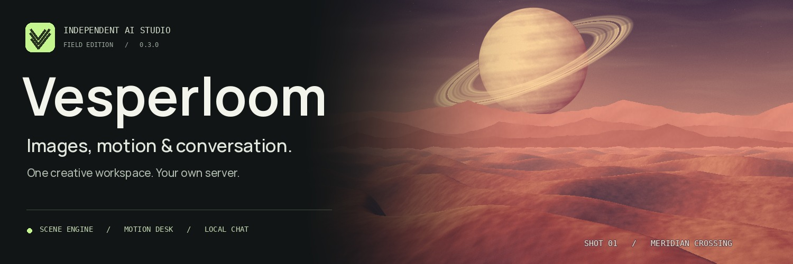
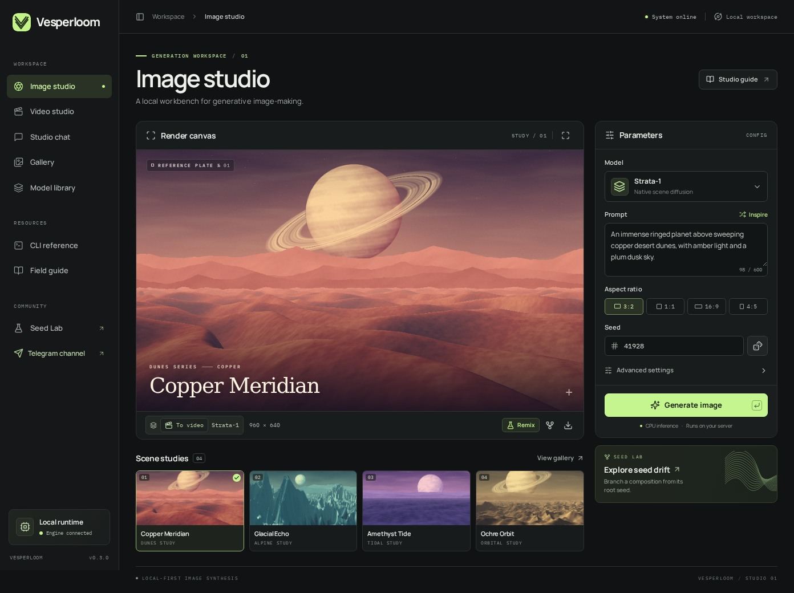

[English](README.md) · [Deutsch](README.de.md) · [Русский](README.ru.md) · **简体中文**

<!-- vesper-community:start -->
[**下载 Seed Lab（HTML） ↓**](app/public/seed-lab.html?raw=true) &nbsp;·&nbsp; [Telegram 频道 · @vesperloom7](https://t.me/vesperloom7)
<!-- vesper-community:end -->

# Vesperloom

**自托管的 AI 图像、视频和聊天工作室：先在对话中构思场景，再生成图像，并将同一场景拍成短片。**

自带的 **Strata-1** 可以直接在 CPU 上绘制风景。生成第一张图不需要 API 密钥、GPU、Python，也不需要另外下载模型。需要更广泛的文生图能力时，可以安装外部模型，并继续使用同一套 React 界面、Node.js API 和命令行工具。

## 三个相连的工作区

- **图像：** 内置 Strata-1 在 CPU 上生成风景。需要处理更广泛的提示词时，可另外安装 SD、SDXL 或 FLUX。
- **视频：** Strata Motion 在生成的地形中移动摄影机，导出 2–4 秒的无声 H.264 MP4，横屏最高可选 1280×720、24 fps。这是场景动画，不是通用视频扩散。需要从文字生成任意场景和动作时，可选 Wan 2.1 T2V 1.3B；需另行下载 28.93 GB 模型组件并配置合适的 GPU 环境。
- **聊天：** 在使用 glibc 的 Linux x86-64 上运行 `npm run chat:setup`，即可安装 CPU 运行时和 Qwen2.5 0.5B（权重 0.49 GB）。也可用 `npm run loom -- pull qwen-7b` 安装 7B 版（另需 4.68 GB），或使用管理员指定的兼容服务。选择远程服务时，本次请求包含的对话将发送给该服务。

在 **Studio chat** 的回复下选择 **To image**，修改提示词并生成图像，再点击 **To video**。对内置模型，这会保留种子和采样设置；对外部模型，只传递提示词和种子，不传递图像像素。切换工作区不会自动开始渲染。

[示例短片（MP4）](app/public/reels/meridian/clip.mp4?raw=true) · [视频界面](docs/media/motion.jpg) · [实际本地对话](docs/media/chat.jpg) · [硬件与安装](docs/MULTIMODAL.md)

## 不安装也能体验模型

**Seed Lab** 将真实的 Strata-1 权重和渲染器打包到一个 HTML 文件中。下载后在浏览器中打开即可离线运行。更换配色或调整 **Seed drift**，导出 1200×630 的明信片，也可以把 `VL1` 种子码发给朋友。每周一（UTC）更新 **Weekly seed**，所有人都从同一颗种子出发。种子码不包含提示词或私人服务器地址。如果 GitHub 显示源代码，点击 **Download raw file**。

发布动态和种子作品见 [Telegram 频道 @vesperloom7](https://t.me/vesperloom7)。分享明信片时附上种子码，别人就能继续创作。如果这个工具对你有帮助，欢迎为仓库加星，让更多人发现它。

[观看种子漂移动画 →](docs/media/seed-drift.gif)

## 快速开始

解压或克隆仓库，进入项目目录。需要 **Node.js 20.19 或更高版本、npm 10 或更高版本**，推荐使用 Node 22。

```bash
npm ci && npm start
```

在 glibc Linux x86-64 上一次启用三个工作区：`npm ci && npm run chat:setup && npm start`。如需邀请多人并隔离数据，请先用 `npm run workspace -- add mira` 等命令分别创建密钥，然后重启服务。

打开 **http://127.0.0.1:4173**，选择一幅参考作品，修改提示词，然后点击 **Generate image**。首次安装 npm 依赖需要联网，之后内置模型可以离线生成图像。英文界面、字体和示例图片都由本机提供。

部署在 VPS 上时，不必对公网开放服务端口。保持默认的本机监听地址，并在自己的电脑上建立 SSH 隧道：

```bash
ssh -L 4173:127.0.0.1:4173 user@your-vps
```

也可以运行 `docker compose up -d --build`，通过容器启动内置引擎并持久化数据。仓库中的容器镜像不包含 GPU 推理环境。



## 两种生成方式

| | 内置 Strata-1 | 外部模型 |
| :--- | :--- | :--- |
| 原理 | 14,612 个参数的去噪网络，加上原创的解析式风景渲染器 | 通过本地 PyTorch 和 Diffusers 执行上游模型 |
| 擅长 | 沙丘、冰川山脊、潮汐海面和行星地貌 | 取决于所选模型的通用文生图能力 |
| 硬件 | CPU 即可 | 通常需要 NVIDIA GPU 和独立的 Python 环境 |
| 分发内容 | 训练代码、3 个真实权重分片、4 幅参考作品 | 4 份固定版本清单，共 74 个组件条目；不打包第三方权重 |

Strata-1 **不是通用的照片级基础模型**。它根据英文关键词选择地貌和配色，再用训练好的扩散先验生成 20 个场景参数，最后渲染为像素。它并不直接从任意文本预测图像。训练数据、网络结构和验证指标见[模型说明](docs/models/STRATA-1.md)。

## 可以尝试的三个功能

1. **种子漂移。** 在画布下选择分支按钮，或点击 **Explore seed drift**。根种子和材质噪声保持不变，滑块改变扩散初始向量的方向。新图会记录它的父图，而不是覆盖原图。
2. **可验证的回放胶囊。** 在导出菜单中保存 PNG，或者保存 JSON 胶囊。胶囊包含提示词、种子、步数、漂移量、画幅、模型指纹和像素 SHA-256。命令行可以重新渲染并比对指纹；如果结果不同，会明确报错。分享前请检查胶囊中的明文提示词。
3. **用同一客户端切换模型。** 通过命令行安装已登记的模型，再从工作室中选择。安装器逐文件校验，全部通过后才提交安装；中断后可以复用已经完整校验的文件。普通生成请求不会自动下载模型。

```bash
npm run loom -- list
npm run loom -- run strata-1 --prompt "Cobalt dunes beneath a ringed planet" --seed 42 --out plate.png
npm run loom -- replay plate.png.capsule.json --out replay.png
```

## 外部模型清单

| 标识 | 模型 | 文件数 | 下载量 |
| :--- | :--- | ---: | ---: |
| `sd15` | Stable Diffusion 1.5 | 15 | 2.74 GB |
| `sdxl` | SDXL Base | 18 | 6.94 GB |
| `sdxl-turbo` | SDXL Turbo | 18 | 6.94 GB |
| `flux-schnell` | FLUX.1 Schnell | 23 | 33.73 GB |

请先按[外部引擎指南](docs/EXTERNAL-MODELS.md)配置环境，并阅读上游许可。以 SD 1.5 为例，执行 `npm run loom -- pull sd15` 下载，再用 `npm run loom -- verify sd15` 完整校验。受限模型需要先获得访问权并提供自己的令牌。`import` 可以从本地目录导入清单指定版本的快照。模型管理与调度由本项目实现，外部模型的张量计算交给 Diffusers；不依赖 Ollama，也不支持任意 GGUF 或 `.ckpt` 文件。

## 运维与开发

每次只运行一个任务，最多允许八个任务排队，单次运行限时 20 分钟。画廊保留最近 64 张成品；重启后成品仍在，内存中的队列不会恢复。可创建具有独立密钥的工作区来隔离画廊、短片和任务；否则使用共享工作区。请勿将其直接用作匿名公共服务。

`app/` 是 React 界面，`engine/strata/` 包含训练和推理代码，`registry/` 保存模型清单，`server/runtime/` 负责队列、存储和胶囊。使用 `npm run dev` 启动开发环境，使用 `npm test` 运行测试。外部适配器已在 CPU 上通过小型随机初始化模型的实际推理测试；没有在当前环境中验证完整权重的 GPU 性能。

[架构说明](docs/ARCHITECTURE.md) · [HTTP API](docs/API.md) · [VPS 部署](docs/DEPLOYMENT.md) · [验证记录](docs/VERIFICATION.md) · [发布步骤](docs/PUBLISHING.md)

**许可证：** 原创代码、Strata-1 权重和参考图片使用 [MIT](LICENSE) 许可证。第三方依赖与外部模型保留各自的许可条款，详见[第三方声明](THIRD_PARTY_NOTICES.md)。
