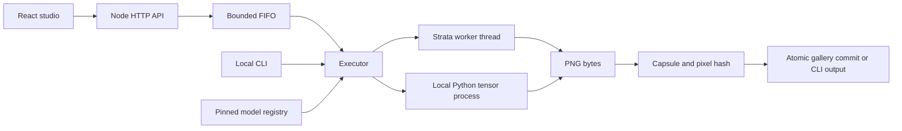

# Anatomy of a render

## Source map

| Boundary | Responsibility |
| :--- | :--- |
| `app/src/components`, `views` | Inspector, keyboard controls, studies, gallery, registry, guide and token gate. All runtime requests are same-origin. |
| `server/api` | HTTP routing, bounded JSON bodies, bearer-token validation, same-site write policy and media streaming. No administrative model downloads over HTTP. |
| `server/runtime/options.mjs` | The single authority for model IDs, geometry, seed bounds and per-model step limits. The client cannot set arbitrary worker paths or image sizes. |
| `server/runtime/queue.mjs` | One active job, up to eight waiting jobs, deadline and cancellation via `AbortSignal`. |
| `server/runtime/execute.mjs` | Native worker-thread lifecycle and Python process boundary. Passes JSON, never a shell command constructed from a prompt. |
| `server/runtime/store.mjs` | Private staging, PNG validation, thumbnails, capsule, atomic publish and retention. |
| `engine/strata` | Router, weights, original DDIM sampler, spherical-body shader, terrain projection and training source. |
| `engine/adapters` | Minimal worker entry points. No remote Python code lookup. |
| `registry` | Five versioned profiles, two interchange schemas, installation receipts and content verification. |
| `bin/loom.mjs` | Headless render/replay, diagnostic, pull/import/verify/remove commands. |

## A transaction, step by step

1. The server normalizes the request. Missing seeds become random unsigned 32-bit integers. An explicit seed of zero is never treated as missing. If supplied, a parent must be a known study or saved render.
2. The queue returns a UUID immediately; the browser polls progress. A ninth waiting job receives HTTP 429, not unbounded memory allocation.
3. Native jobs start a worker thread. External jobs start a local-only tensor process. Cancellation terminates the worker; a deadline failure is reported separately from user cancellation.
4. Output lands in `renders/.work-<uuid>/`. The store decodes the PNG, checks dimensions, hashes both RGBA bytes and encoded PNG bytes, and writes a thumbnail, capsule and gallery record.
5. A final cancellation check precedes the commit. A same-filesystem directory rename makes all artifacts visible together. Cancellation cannot retract an already committed image.
6. The newest **64 renders** are retained. In-process job history is capped at **128 entries**; jobs are ephemeral across restart. Boot discards interrupted work and reloads committed gallery records. Use **one server process per data directory**.

## Reproducibility boundaries

The portable [capsule schema](../registry/schemas/capsule.schema.json) includes a release version, checkpoint/profile fingerprint, settings, parent reference and two SHA-256 hashes. `loom replay` validates model identity and compares decoded pixel bytes. Identical PNG encoding is not required for a pixel match. Cross-version or cross-platform floating-point kernels can differ, particularly on GPUs. A differing digest is an explicit failure, not silently declared a successful replay.

**Seed drift** changes the starting latent direction while preserving material-noise fields. Forking records lineage; it is not image-to-image inference, training on a previous PNG, or a claim that an arbitrary seed can be interpolated across architectures. Imported capsules load settings in the UI; the CLI performs the verified replay.

## Trust model

The CLI and local filesystem are trusted administrator interfaces. Without a named registry the web app is a **shared studio**: a legacy token is not tenant isolation. With named keys, every job lookup, cancellation, generated-media download and gallery lookup is scoped to the authenticated workspace. Users cannot select a workspace path in a request. Model weights and the bounded visual queue remain global. Keep the API private or place it behind TLS, authentication and a rate-limiting proxy. There is no public anonymous service, durable distributed queue or persistent GPU residency in this release.

## Motion and language paths · 0.3

- `server/accounts/` maps a bearer key digest to one store namespace. `server/api/app.mjs` loads a per-workspace image/clip store, keeps the model home global, and attaches the owner when submitting a visual job. Only the owner may retrieve/cancel it. Finished media commits by rename out of a temporary directory; partial work is removed on failure/startup.
- `engine/motion/scene.mjs` samples the learned scene once per shot. Each frame transforms the camera in world coordinates, updates atmospheric displacement and tidal phase, then projects the surface. `encode-worker.mjs` hashes the raw frames, encodes a H.264 master and smaller all-keyframe VP8 proxy, and extracts a poster and 5-frame strip. `webm.mjs` is a bounded single-track EBML writer, not a general codec. The separately registered Wan worker denoises **temporal latents**, writes validated RGB frames, and uses the same output path.
- `server/chat/` validates alternating history and streams NDJSON. Local chat spawns an isolated `runtimes/chat-linux-x64/worker.mjs`: it loads the pinned GGUF into llama.cpp, budgets context, yields tokens over IPC, then disposes the model. Connection loss and deadline terminate the child. The optional configured provider is an alternative **chat-only** route; SSE is normalized server-side. HTTP endpoints, models, and provider credentials cannot be supplied in user messages.
- Browser `useConversation` and `useMotionDesk` live above individual page components, so switching desks preserves the work. A pending visual job ID survives a tab reload; tokens and chat text do not. Private video playback fetches a bounded clip as an authenticated blob, without putting credentials in a URL.
